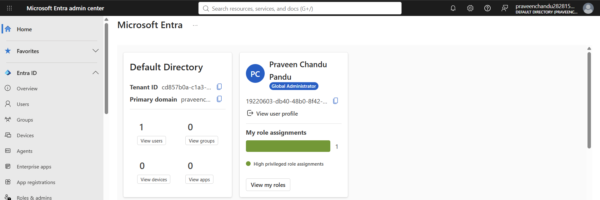
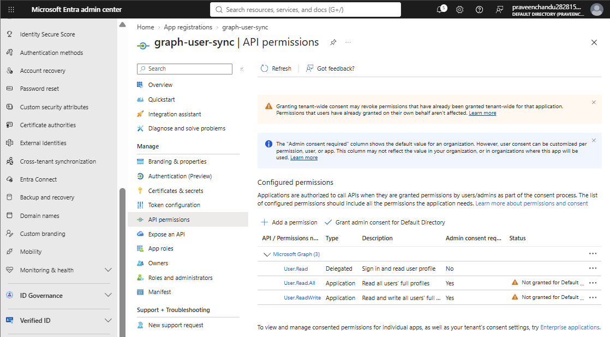
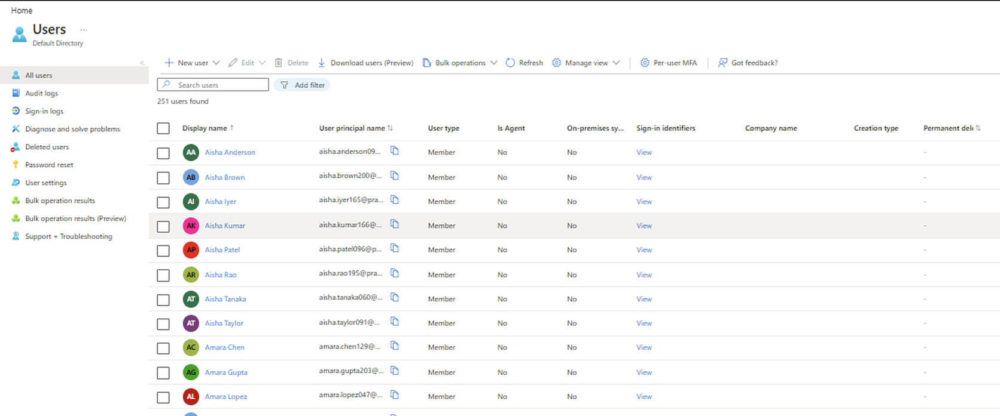

# graph-user-sync

This is my solution to the API integration exercise. It's a Python script that pulls user information from Microsoft Graph, converts each user into a clean JSON record, and sends those records to a mock REST API.

To make it feel realistic, I imagined a university that keeps its students, faculty and staff in Microsoft Entra ID and needs them copied into an HR system. I didn't want to touch any real organization's data, so I set up my own Entra test tenant and filled it with 250 made-up users. With my admin account that's 251 users in total, and every log in this repo comes from running against that tenant.


---

## The short version

- Login uses MSAL with the client credentials flow, and the secret stays in a local `.env` file that never goes to GitHub.
- Users are read with `GET /v1.0/users`, 100 per page, following `@odata.nextLink` until there are no pages left.
- Each user is mapped to my own JSON format. Missing fields don't crash anything; they get a fallback or `null`, plus a warning in the log.
- Records are sent with `POST /users` to a small Flask API I wrote, which fails on purpose now and then (500s and 429s) so the retry logic actually gets exercised.
- A small SQLite database remembers which users were already sent, along with a hash of their data. Running the script twice doesn't send anyone twice; only new or changed users go out.

What happened when I ran it:

| Run | Result |
|---|---|
| First run | 251 users read in 3 pages (100 + 100 + 51), 251 sent, 0 failed. It recovered from 12 HTTP 500s and 4 HTTP 429s along the way. |
| Second run | 251 read, 0 sent, 251 skipped because nothing had changed |
| After I changed one user's department | 1 updated, 250 skipped |

---

## How I did it, step by step

These are the steps in the order I actually did them, with the command, which part of the code runs, and what came out.

### Step 1: Set up Microsoft Entra ID (in the portal, no code)

My college account doesn't have admin rights (I tried, and got a 403), so I created a free Azure account with a personal Microsoft account. That gave me my own tenant ("Default Directory") where I'm Global Administrator.



In the Entra admin center I then:
1. Registered an app called `graph-user-sync` (single tenant). This gives the script its own identity, the **Client ID**.
2. Created a client secret under *Certificates & secrets*. This is the script's password.
3. Added the Microsoft Graph **application** permission `User.Read.All`, so it can read users without anyone signing in.
4. Clicked **Grant admin consent**. I forgot this the first time, and you can see what happened in Step 4.

I also added `User.ReadWrite.All` for a while so I could create test users (Step 5), and removed it afterwards. The sync itself only needs read access.

### Step 2: Install the project

```powershell
python -m venv .venv
.\.venv\Scripts\Activate.ps1
pip install -r requirements.txt
```

This creates a separate Python environment for the project and installs the four libraries it uses: `msal` (Microsoft login), `requests` (HTTP calls), `python-dotenv` (reads `.env`) and `flask` (the mock API).

```
Successfully installed ... flask-3.1.3 ... msal-1.39.0 ... python-dotenv-1.2.4 ... requests-2.34.2 ...
```

### Step 3: Add my settings

```powershell
Copy-Item .env.example .env
notepad .env
```

I filled in `TENANT_ID`, `TENANT_DOMAIN`, `CLIENT_ID` and `CLIENT_SECRET`. The code that reads them is `src/config.py`. If any of them is missing, the script stops right away and says which one. `.env` is listed in `.gitignore`, so it never gets committed.

### Step 4: Test the connection with a dry run

```powershell
python -m src.main --dry-run
```

`--dry-run` logs in, reads and transforms the users, but sends nothing. The code involved is `src/main.py` → `src/auth.py` (get the token) → `src/graph_client.py` (GET users) → `src/transform.py`.

My first try failed, because I hadn't granted admin consent yet:

```
00:18:09 | INFO    | auth   | Obtained new Microsoft Graph access token
00:18:10 | ERROR   | sync   | Reading users from Microsoft Graph failed: GET graph.microsoft.com/v1.0/users -> HTTP 403: {"error":{"code":"Authorization_RequestDenied","message":"Insufficient privileges to complete the operation." ...
```

The login itself worked (I got a token), but Graph wouldn't let the app read users. The API permissions page showed why: both application permissions were still "Not granted":



The script logged the error and exited cleanly instead of crashing. After I granted admin consent, the same command worked:

```
00:22:49 | INFO    | auth   | Obtained new Microsoft Graph access token
00:22:50 | INFO    | graph  | Graph page 1: received 1 users (last page)
00:22:50 | WARNING | sync   | user 19220603-...: no mail, used userPrincipalName as email
00:22:50 | WARNING | sync   | user 19220603-...: missing fields set to null: job_title, department, office
00:22:50 | INFO    | sync   |   fetched              1
00:22:50 | INFO    | sync   |   would_send_new       1
```

Only one user at this point: me. My own admin account has no email, job title or department, so it was already a good first test of the missing-data handling.

### Step 5: Create test users

```powershell
python -m scripts.seed_users
```

Typing in 250 users by hand wasn't realistic, so `scripts/seed_users.py` creates them through Graph (`POST /v1.0/users`). It makes students, faculty and staff with university-style departments, and deliberately leaves out some fields (department, job title, email, office) for about 10% of them, so the sync has messy data to deal with.

```
00:26:28 | INFO | seed | created 25 users so far...
...
00:27:53 | INFO | seed | created 250 users so far...
00:27:53 | INFO | seed | Done. created=250, already existed=0, failed=0
```

Afterwards the Users page in Entra showed **251 users found**: the 250 test users plus my admin account.



This script is only for preparing test data. It isn't part of the sync.

### Step 6: Start the mock REST API

In a second PowerShell window:

```powershell
python mock_api/server.py
```

```
00:33:33 | MOCK-API | Mock API on http://127.0.0.1:5000  (500 rate=5%, 429 rate=3%)
```

`mock_api/server.py` is a small Flask app that plays the role of the HR system. It runs on my own machine and has three endpoints:

| Endpoint | What it does |
|---|---|
| `GET /health` | Returns `{"status": "ok"}`. The sync checks this first. |
| `POST /users` | Stores a user and returns **201** (new) or **200** (updated). Returns **409** if it has already seen the same `Idempotency-Key`, and **400** if the body is invalid. |
| `GET /users` | Lists everything it has received. You can open it in a browser. |

On about 5% of POSTs it returns a **500**, and on about 3% a **429** with `Retry-After: 2`. A mock that always succeeds would never test the retry code, so I made it fail on purpose.

### Step 7: Run the sync (first run)

```powershell
python -m src.main
```

This time everything runs, including sending: `main.py` → `auth.py` → `graph_client.py` (GET, page by page) → `transform.py` → `state_store.py` (already sent?) → `api_client.py` (POST) → `http_client.py` (retries).

Reading the pages:
```
00:34:17 | INFO    | auth   | Obtained new Microsoft Graph access token
00:34:18 | INFO    | graph  | Graph page 1: received 100 users (more pages available)
00:34:34 | INFO    | graph  | Graph page 2: received 100 users (more pages available)
00:34:44 | INFO    | graph  | Graph page 3: received 51 users (last page)
```

Users with missing data:
```
00:34:18 | WARNING | sync   | user 6632aba0-...: missing fields set to null: department
00:34:20 | WARNING | sync   | user 77af646e-...: no mail, used userPrincipalName as email
```

A 500 from the mock API. The script waits a bit longer each time and then succeeds:
```
00:34:28 | WARNING | http   | POST 127.0.0.1:5000/users -> HTTP 500 | attempt 1/5, retrying in 1.4s
00:34:29 | WARNING | http   | POST 127.0.0.1:5000/users -> HTTP 500 | attempt 2/5, retrying in 2.2s
00:34:32 | INFO    | sync   | user 1948fa79-...: created (new)
```

A 429. The script waits exactly the 2 seconds the server asked for:
```
00:34:24 | WARNING | http   | POST 127.0.0.1:5000/users -> HTTP 429 (server asked to wait 2s via Retry-After) | attempt 1/5, retrying in 2.0s
00:34:26 | INFO    | sync   | user 7c421021-...: created (new)
```

The same moment, seen from the mock API's window:
```
00:34:24 | MOCK-API | injected 429 Too Many Requests (Retry-After: 2s)
00:34:26 | MOCK-API | created user 7c421021-... (total stored: 45)
```

The summary at the end:
```
00:34:48 | INFO    | sync   | === Summary (run edfb59d9, 31.6s) ===
00:34:48 | INFO    | sync   |   fetched              251
00:34:48 | INFO    | sync   |   created              251
00:34:48 | INFO    | sync   |   with_missing_fields  67
00:34:48 | INFO    | sync   |   failed               0
```

All the transformed records are also saved to `output/users.json`. A copy is in `sample_output/`.

### Step 8: Check what the API received

The mock API window ended with `created user ... (total stored: 251)`, so every record arrived. While the mock API is running, you can also open `http://127.0.0.1:5000/users` in a browser to see them all. Here's what one record looks like (a user with no job title or department):

```json
{
  "source_id": "…",
  "full_name": "Emily Hassan",
  "first_name": "Emily",
  "last_name": "Hassan",
  "email": "emily.hassan003@<tenant>.onmicrosoft.com",
  "username": "emily.hassan003@<tenant>.onmicrosoft.com",
  "job_title": null,
  "department": null,
  "office": "Science Hall 210",
  "is_active": true,
  "source": "microsoft_graph",
  "missing_fields": ["job_title", "department"],
  "synced_at": "2026-10-27T04:34:16+00:00"
}
```

### Step 9: Run it again (testing duplicates)

```powershell
python -m src.main
```

```
00:38:11 | INFO    | sync   | === Summary (run 60eb30d5, 1.8s) ===
00:38:11 | INFO    | sync   |   fetched              251
00:38:11 | INFO    | sync   |   skipped_unchanged    251
00:38:11 | INFO    | sync   |   failed               0
```

All 251 users were still read from Graph, but nothing was sent. For each user, `state_store.py` found the same ID with the same hash, so it skipped them. The mock API window stayed quiet.

### Step 10: Change one user and run again

In the Entra portal I opened one test user and changed their department. Then:

```powershell
python -m src.main
```

```
00:40:30 | INFO    | sync   | user 0b38a743-...: updated (changed)
00:40:31 | INFO    | sync   |   fetched              251
00:40:31 | INFO    | sync   |   updated              1
00:40:31 | INFO    | sync   |   skipped_unchanged    250
```

That user's hash changed, so only that one was sent again, and the mock API returned 200 "updated".

---

## HTTP status codes

| Code | Meaning | Where it shows up |
|---|---|---|
| 200 OK | Request worked | Every Graph page read (`Graph page 1: received 100 users`), `GET /health`, and the update in Step 10 |
| 201 Created | New record stored | Each `created user` line in the mock API and `created (new)` in the sync log |
| 400 Bad Request | Invalid body | Returned by the mock API if `source_id` is missing. Not retried, because sending the same bad request again won't help. My runs never sent one. |
| 401 Unauthorized | No valid token | Graph returns this without a token. Not retried. |
| 403 Forbidden | Logged in, but not allowed | My first dry run, before admin consent (Step 4). Logged clearly, exit code 2. |
| 409 Conflict | Already received this exact record | The mock API's response to a repeated `Idempotency-Key`. The script treats it as "already done". It didn't come up in my runs, because the SQLite check skips those users before they're sent. |
| 429 Too Many Requests | Slow down | 4 times in run 1. The script waited the `Retry-After` seconds, then retried. |
| 500 Internal Server Error | Server failed | 12 times in run 1. The script retried with backoff (about 1s, 2s, 4s, 8s), up to 5 attempts. |

All the retry rules live in one place, `src/http_client.py`, so Graph calls and API calls are handled the same way.

---

## Where each requirement is handled

| Requirement | File | How |
|---|---|---|
| Authentication & credentials | `src/auth.py`, `src/config.py` | MSAL client credentials flow. Secret loaded from `.env` (git-ignored) and never logged. Read-only permission. |
| REST GET / POST | `src/graph_client.py`, `src/api_client.py` | GET users from Graph, POST records to the mock API |
| JSON transformation | `src/transform.py` | Field mapping (below). Output saved to `users.json`. |
| Pagination | `src/graph_client.py` | `$top=100` and `@odata.nextLink` |
| Missing data | `src/transform.py` | Fallbacks, `null`, a `missing_fields` list and a warning. A record without an `id` is skipped. |
| Errors, retries, logging | `src/http_client.py`, `src/logger.py` | Shared retry function. Logs go to the console and to a file, and contain user IDs only, no names or emails. |
| 429 / 500 | `src/http_client.py` | `Retry-After` for 429, exponential backoff for 5xx |
| Duplicates | `src/state_store.py`, `src/api_client.py` | SQLite (user ID + hash), saved only after a successful send, plus an `Idempotency-Key` header |

Field mapping:

| Graph | My JSON | If it's missing |
|---|---|---|
| `id` | `source_id` | record skipped |
| `displayName` | `full_name` | built from first + last name |
| `givenName`, `surname` | `first_name`, `last_name` | `null` |
| `mail` | `email` | use `userPrincipalName` |
| `userPrincipalName` | `username` | `null` |
| `jobTitle` | `job_title` | `null` + warning |
| `department` | `department` | `null` + warning |
| `officeLocation` | `office` | `null` |
| `accountEnabled` | `is_active` | `null` |

---

## Running it on another machine

You need Python 3.10 or newer, Git, internet access, and an Entra app registration with `User.Read.All` (application permission, admin consent granted).

```powershell
git clone https://github.com/praveenchandupandu/graph-user-sync
cd graph-user-sync
python -m venv .venv
.\.venv\Scripts\Activate.ps1          # if blocked: Set-ExecutionPolicy -Scope Process Bypass
pip install -r requirements.txt
Copy-Item .env.example .env           # then fill in your tenant ID, client ID and secret
```

Window 1:
```powershell
python mock_api/server.py
```

Window 2:
```powershell
python -m src.main --dry-run          # read + transform only
python -m src.main                    # full sync
python -m src.main                    # second run: everything skipped
```

Then open `http://127.0.0.1:5000/users` to see what arrived. To run without injected errors, set `$env:FAIL_500_RATE=0` and `$env:FAIL_429_RATE=0` before starting the mock API. To start fresh, delete the `state` folder.

If I'm demoing on someone else's laptop, I create a short-lived client secret just for the demo and delete it afterwards, so my normal secret never ends up on another machine.

---

## Project layout

```
src/
  main.py            runs everything in order and prints the summary
  config.py          reads settings from .env
  auth.py            gets the Microsoft Graph token (MSAL)
  graph_client.py    GET users, page by page
  transform.py       Graph JSON -> my JSON, missing-data rules, hash
  state_store.py     SQLite record of what's been sent
  api_client.py      POST to the mock API
  http_client.py     retry rules for 429 / 5xx
  logger.py          console + file logging
mock_api/server.py   the mock REST API (Flask)
scripts/seed_users.py  creates the 250 test users (setup only)
docs/                architecture diagram
sample_output/       logs and users.json from my runs (see the README inside)
```

---

## Decisions I made

- **Plain REST calls instead of the Graph SDK.** The SDK handles paging and some retries for you, but the exercise asks to show those things, so I wrote them myself with `requests`.
- **A mock that fails on purpose.** Otherwise there's no evidence that the 429/500 handling works.
- **Least privilege.** The sync only has `User.Read.All`. The write permission was only there while I created the test users.
- **Privacy.** Logs only contain user IDs. In a university setting student data is protected (FERPA), which is also why I tested in my own tenant with fake users.
- **One bad record doesn't stop the run.** If a user still fails after 5 attempts, it's logged and the run moves on. Because it isn't saved to the state store, it's tried again next run.
- **A full sync each run.** Fine at this size. For a real deployment I'd switch to delta queries (see below).
- **My own target format.** The exercise didn't specify one, so I designed the field mapping above.

---

## Three things I'd change before production

1. **No secret in a file.** I'd run it in Azure with a Managed Identity, so there's no secret at all, or use a certificate kept in Azure Key Vault instead of a client secret.

2. **Only fetch what changed.** Graph's delta query (`/users/delta`) returns only new, changed and deleted users since the last run, which is much faster for a large university and also catches deletions. I'd move the state from local SQLite to a shared database, so two runs at the same time can't process the same users.

3. **Monitoring and a failure queue.** I'd send the logs to Azure Monitor / Application Insights with alerts when a run fails, and put records that keep failing into a dead-letter queue so someone can review and replay them, instead of them only showing up in a log file. It would run on a schedule (for example an Azure Function timer) with a lock so only one run happens at a time.
