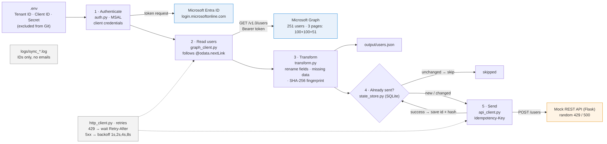

# graph-user-sync

A Python application that **retrieves users from Microsoft Graph**, **transforms them into JSON**, and **sends the records to a mock REST API**. It handles authentication, pagination, missing data, retries (including HTTP 429 and 500), logging, and duplicate prevention.

**Scenario:** a university keeps its students, faculty and staff in Microsoft Entra ID and needs them copied into an HR / student-information system. The solution was run against my **own Microsoft Entra test tenant** containing **251 fictional users**. No real personal data was used.

---

## Results at a glance

These are real runs against Microsoft Graph. Full logs are in [`sample_output/`](sample_output/).

| Run | What happened | Requirement shown |
|---|---|---|
| **Run 1** | 251 users read in **3 pages** (100 + 100 + 51), all **251 created** in the mock API, **0 failed**. 16 injected errors (12 × HTTP 500, 4 × HTTP 429) were retried and recovered. 67 users had missing fields and were handled. | GET, POST, pagination, JSON, missing data, 429/500, retries |
| **Run 2** | 251 read, **0 sent, 251 skipped (unchanged)** | Duplicate prevention |
| **Run 3** | One user's department changed in Entra → **1 updated, 250 skipped** | Change detection |
| **Before admin consent** | Graph returned **HTTP 403**. The script logged a clear error and exited cleanly (exit code 2). | Error handling |

---

## Architecture



**How one run works:**

1. **Load settings:** Tenant ID, Client ID and Client Secret are read from a local `.env` file, which is never committed.
2. **Authenticate:** MSAL performs the OAuth 2.0 *client credentials* flow with Microsoft Entra ID and returns an access token (valid ~1 hour, cached and refreshed automatically).
3. **Read users (GET):** `GET https://graph.microsoft.com/v1.0/users` with `$select` (only needed fields) and `$top=100`. The script follows `@odata.nextLink` until no more pages remain.
4. **Transform:** each Graph user is mapped to the target JSON format, missing values are handled, and a SHA-256 fingerprint of the record is computed.
5. **Check for duplicates:** a SQLite state store answers *new / changed / unchanged*. Unchanged users are skipped.
6. **Send (POST):** new or changed users are posted to the mock API with an `Idempotency-Key` header. 429 and 5xx responses are retried. On success, the user ID and fingerprint are saved to the state store.

Finally, all transformed records are written to `output/users.json`, and a summary is logged.

---

## How each requirement is met

| Requirement | Implementation | File |
|---|---|---|
| **Authentication & secure credential handling** | OAuth 2.0 client credentials via **MSAL**. Secrets live only in `.env` (git-ignored); `.env.example` documents the variables. The secret is excluded from object printing and never logged. The app has **read-only** permission (`User.Read.All`). | [`src/auth.py`](src/auth.py), [`src/config.py`](src/config.py), [`.gitignore`](.gitignore) |
| **REST GET / POST** | `GET /v1.0/users` on Microsoft Graph; `POST /users` on the mock API | [`src/graph_client.py`](src/graph_client.py), [`src/api_client.py`](src/api_client.py) |
| **JSON transformation** | Graph fields mapped to a clean target schema (table below). Output saved to `output/users.json`. | [`src/transform.py`](src/transform.py) |
| **Pagination** | `$top=100`, following `@odata.nextLink` until absent | [`src/graph_client.py`](src/graph_client.py) |
| **Handling missing data** | Empty strings are treated as missing. No `mail` → `userPrincipalName` used as email. No `displayName` → built from first + last name. No `id` → record skipped. Other gaps → `null`, listed in `missing_fields`, with a warning logged. One bad record never stops the run. | [`src/transform.py`](src/transform.py) |
| **Error handling, retries, logging** | One shared retry function for all HTTP calls. Logs go to the console and to a timestamped file in `logs/`. Only user **IDs** are logged, never names or emails. A summary is printed with each run. Exit codes: `0` ok, `1` some records failed, `2` fatal. | [`src/http_client.py`](src/http_client.py), [`src/logger.py`](src/logger.py), [`src/main.py`](src/main.py) |
| **HTTP 429 and 500** | **429** → wait the number of seconds in the `Retry-After` header. **500/502/503/504** and network errors → exponential backoff with jitter (~1s, 2s, 4s, 8s), max 5 attempts. **Other 4xx** (400/401/403/404) → not retried, because the request itself is wrong. | [`src/http_client.py`](src/http_client.py) |
| **Preventing duplicate processing** | **Layer 1:** SQLite stores `user id + SHA-256 hash` of each record sent. Unchanged → skip; changed → re-send as an update. A record is saved **only after** the API confirms success, so failures are retried on the next run. **Layer 2:** an `Idempotency-Key` header lets the API reject an exact repeat (409). **Layer 3:** a user appearing twice within one run is ignored. | [`src/state_store.py`](src/state_store.py), [`src/api_client.py`](src/api_client.py), [`src/main.py`](src/main.py) |

### Field mapping

| Microsoft Graph | Target JSON | If missing |
|---|---|---|
| `id` | `source_id` | record skipped (cannot be tracked) |
| `displayName` | `full_name` | built from `givenName` + `surname` |
| `givenName` / `surname` | `first_name` / `last_name` | `null` |
| `mail` | `email` | falls back to `userPrincipalName` |
| `userPrincipalName` | `username` | `null` |
| `jobTitle` | `job_title` | `null` + warning |
| `department` | `department` | `null` + warning |
| `officeLocation` | `office` | `null` |
| `accountEnabled` | `is_active` | `null` |
| *(added)* | `source`, `missing_fields`, `synced_at` | — |

---

## What a run looks like (excerpts from the real logs)

**Authentication and pagination:**
```
00:34:17 | INFO    | auth   | Obtained new Microsoft Graph access token
00:34:18 | INFO    | graph  | Graph page 1: received 100 users (more pages available)
00:34:34 | INFO    | graph  | Graph page 2: received 100 users (more pages available)
00:34:44 | INFO    | graph  | Graph page 3: received 51 users (last page)
```

**Missing data handled, not crashed:**
```
00:34:18 | WARNING | sync   | user 6632aba0-...: missing fields set to null: department
00:34:20 | WARNING | sync   | user 77af646e-...: no mail, used userPrincipalName as email
```

**HTTP 500: exponential backoff, then success:**
```
00:34:28 | WARNING | http   | POST 127.0.0.1:5000/users -> HTTP 500 | attempt 1/5, retrying in 1.4s
00:34:29 | WARNING | http   | POST 127.0.0.1:5000/users -> HTTP 500 | attempt 2/5, retrying in 2.2s
00:34:32 | INFO    | sync   | user 1948fa79-...: created (new)
```

**HTTP 429: waits exactly as long as the server asks:**
```
00:34:24 | WARNING | http   | POST 127.0.0.1:5000/users -> HTTP 429 (server asked to wait 2s via Retry-After) | attempt 1/5, retrying in 2.0s
00:34:26 | INFO    | sync   | user 7c421021-...: created (new)
```

**Summaries of the three runs:**
```
Run 1:  fetched 251 | created 251           | with_missing_fields 67 | failed 0
Run 2:  fetched 251 | skipped_unchanged 251 | with_missing_fields 67 | failed 0
Run 3:  fetched 251 | updated 1 | skipped_unchanged 250              | failed 0
```

**Error handling (before admin consent was granted):**
```
00:18:09 | INFO    | auth   | Obtained new Microsoft Graph access token
00:18:10 | ERROR   | sync   | Reading users from Microsoft Graph failed: GET graph.microsoft.com/v1.0/users -> HTTP 403: Authorization_RequestDenied
```

### Example transformed record (format)
```json
{
  "source_id": "00000000-0000-0000-0000-000000000003",
  "full_name": "Emily Hassan",
  "first_name": "Emily",
  "last_name": "Hassan",
  "email": "emily.hassan003@<tenant>.onmicrosoft.com",
  "username": "emily.hassan003@<tenant>.onmicrosoft.com",
  "job_title": null,
  "department": null,
  "office": "Science Hall 210",
  "is_active": true,
  "source": "microsoft_graph",
  "missing_fields": ["job_title", "department"],
  "synced_at": "2026-10-27T04:34:16+00:00"
}
```

---

## Sample output

| File in [`sample_output/`](sample_output/) | What it shows |
|---|---|
| `sync_20261027_001808.log` | First attempt: **HTTP 403** before admin consent, handled cleanly |
| `sync_20261027_002249.log` | Dry run after consent: login + read works (1 user, before seeding) |
| `sync_20261027_002617.log` | One-time setup: 250 test users created in the test tenant |
| `sync_20261027_003416.log` | **Run 1:** 251 users, 3 pages, 429/500 retries, all sent |
| `sync_20261027_003809.log` | **Run 2:** all 251 skipped, so no duplicate processing |
| `sync_20261027_004029.log` | **Run 3:** 1 changed user updated, 250 skipped |
| `users.json` | All transformed records from the latest run |

---

## Project structure

```
graph-user-sync/
├── src/                     the sync application
│   ├── main.py              orchestrates a run and prints the summary
│   ├── config.py            loads and validates settings from .env
│   ├── auth.py              MSAL client-credentials authentication
│   ├── graph_client.py      GET users from Microsoft Graph with pagination
│   ├── transform.py         Graph JSON → target JSON, missing-data rules, fingerprint
│   ├── state_store.py       SQLite store for duplicate prevention
│   ├── api_client.py        POST records to the target API (Idempotency-Key)
│   ├── http_client.py       shared retry logic (429 Retry-After, 5xx backoff)
│   └── logger.py            console + file logging
├── mock_api/
│   └── server.py            Flask mock REST API with random 429/500 injection
├── scripts/
│   └── seed_users.py        one-time setup: creates 250 fictional users in a test tenant
├── docs/
│   ├── architecture.png     architecture diagram
│   └── architecture.mmd     diagram source (Mermaid)
├── sample_output/           logs and JSON from the real runs
├── .env.example             template for required settings (no secrets)
├── .gitignore               keeps .env, state, logs and output out of Git
└── requirements.txt         msal, requests, python-dotenv, flask
```

### The mock REST API

`mock_api/server.py` is a small **Flask** web server that stands in for the HR system. It runs locally at `http://127.0.0.1:5000`.

| Endpoint | Purpose |
|---|---|
| `GET /health` | Health check; the sync calls it first and stops early if the API is down |
| `POST /users` | Receives a record → `201 created`, `200 updated`, `409 duplicate` (same Idempotency-Key), or `400 invalid` |
| `GET /users` | Lists everything received (also viewable in a browser) |

To prove the retry logic, it **fails on purpose**: about 5% of POSTs return **500** and about 3% return **429** with `Retry-After: 2`. This is configurable with `FAIL_500_RATE` and `FAIL_429_RATE` (set both to `0` for a clean run).

---

## Setup and run (Windows PowerShell)

**1. Microsoft Entra ID (one time)**
1. Use a test tenant where you are an administrator. Never develop against real user data.
2. **App registrations → New registration** → name `graph-user-sync`, *Single tenant* → Register. Note the **Application (client) ID** and **Directory (tenant) ID**.
3. **Certificates & secrets → New client secret** → copy the **Value**.
4. **API permissions → Add a permission → Microsoft Graph → Application permissions → `User.Read.All`** → **Grant admin consent**.
   *(To create test users with `scripts/seed_users.py`, also add `User.ReadWrite.All` temporarily, and remove it after seeding.)*

**2. Install**
```powershell
cd graph-user-sync
python -m venv .venv                  # create an isolated Python environment for this project
.\.venv\Scripts\Activate.ps1          # activate it (if blocked: Set-ExecutionPolicy -Scope Process Bypass)
pip install -r requirements.txt       # install msal, requests, python-dotenv, flask
Copy-Item .env.example .env           # create your settings file, then fill in your IDs and secret
```

**3. Run**
```powershell
# Window 1: start the mock REST API (leave it running)
python mock_api/server.py

# Window 2
python -m scripts.seed_users          # optional, one time: create 250 test users
python -m src.main --dry-run          # read + transform only, nothing is sent
python -m src.main                    # full sync
python -m src.main                    # run again: everything is skipped (no duplicates)
```
Received records can be viewed at `http://127.0.0.1:5000/users`.

---

## Design decisions and assumptions

- **Plain REST calls instead of the Graph SDK.** The SDK hides pagination and retry behaviour. Using `requests` directly makes those mechanisms explicit and demonstrable, as the exercise asks.
- **A mock API that fails on purpose.** A perfect mock would never exercise the 429/500 handling. Random fault injection proves it in real logs.
- **Least privilege.** The sync needs only `User.Read.All` (application permission). Write access was granted temporarily to seed test data and removed afterwards.
- **Privacy.** Logs contain user IDs only. Testing used a separate tenant with fictional users, which matters in a university setting (FERPA).
- **Partial failure.** A record that still fails after all retries is logged and the run continues. Because it is not saved in the state store, it is retried automatically on the next run.
- **Full sync each run.** Simple and correct for the exercise. Incremental sync is listed below as a production change.
- **Target schema.** No schema was provided, so I designed the mapping above.
- **Deletions.** Disabled users are sent with `is_active: false`. Deleted users are out of scope (handled by delta query in production).

---

## Three changes before deploying to production

1. **Remove secrets from files: Managed Identity / Key Vault.**
   Run the job in Azure with a **Managed Identity** (no secret at all), or use a **certificate stored in Azure Key Vault** instead of a client secret. Rotate credentials and keep permissions at `User.Read.All` only.

2. **Incremental sync with durable, shared state.**
   Use Microsoft Graph **delta queries** (`/users/delta`) so each run fetches only changes, including deletions, instead of every user. Move the state from local SQLite to a managed database (e.g. Azure SQL) so scheduled or parallel runs cannot double-process.

3. **Monitoring, alerting and failure recovery.**
   Send structured logs to **Azure Monitor / Application Insights** with alerts on failures. Put records that fail permanently on a **dead-letter queue** for review and replay instead of only logging them. Run it on a schedule (e.g. an Azure Function timer or Container Apps job) with a lock so only one run executes at a time.
